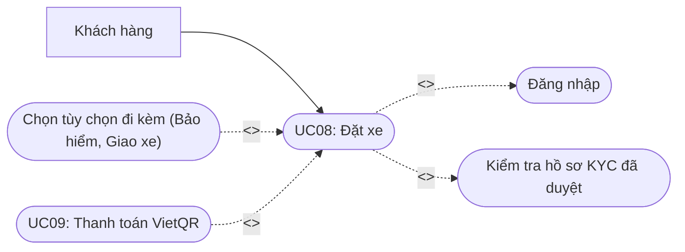
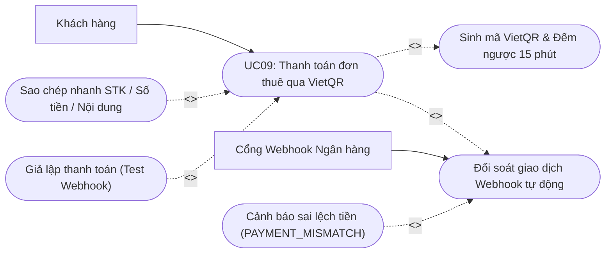
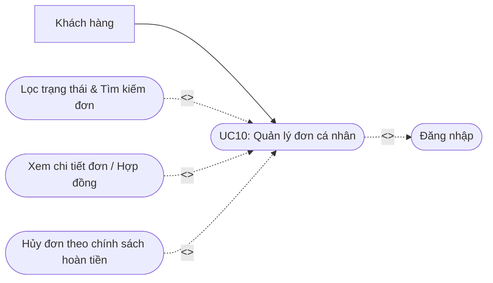
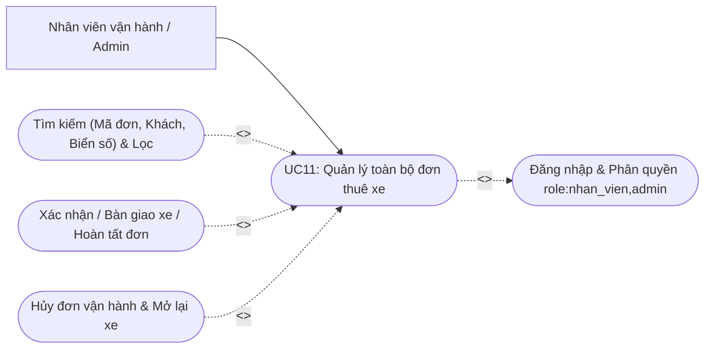
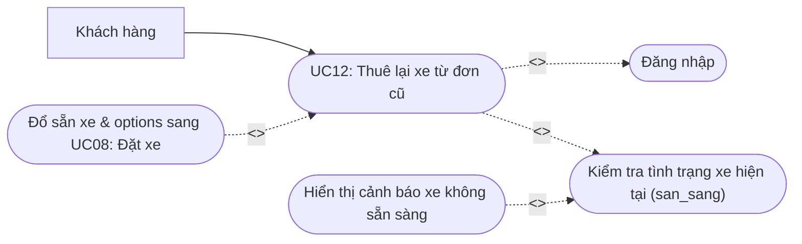
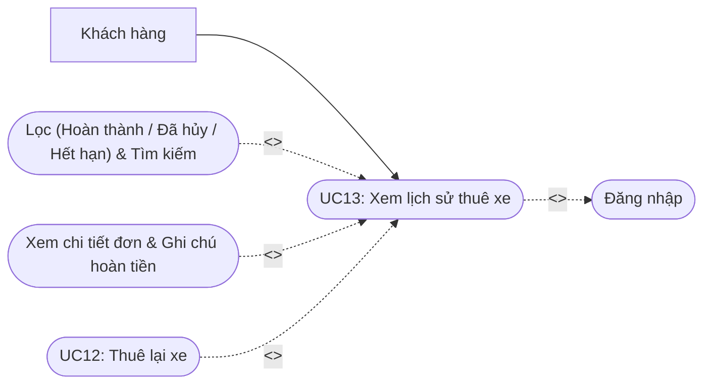

# PHÂN CÔNG TRELLO & ĐẶC TẢ USE CASE SPRINT 2 (UC08 – UC13)

Tài liệu này được xây dựng dựa trên lịch sử đóng góp Git thực tế của 6 thành viên trên hai repository `BE_CS403_G` và `FE_CS403_G`, đồng thời bám sát **100% luồng nghiệp vụ đang vận hành trong mã nguồn**.

---

## 1. Bảng tổng quan phân công & Cấu trúc Thẻ Trello (Sprint 2)

| STT | Thành viên | Mã PB / UC | Tên Card Trello | Độ ưu tiên | Checklist công việc trên Trello |
|---|---|---|---|---|---|
| 1 | **Nguyễn Lê Minh Tuấn** | `PB08` / `UC08` | **[PB08] Đặt xe (Khách hàng đã xác thực KYC)** | Cao | - [x] Kiểm tra trạng thái duyệt hồ sơ `HoSoXacThuc` (`da_duyet`), chặn `403` nếu chưa xác thực - [x] Xử lý `DB::transaction` + `lockForUpdate` chống đặt trùng lịch xe - [x] Tính tổng tiền thuê làm tròn theo chu kỳ 24h + phí tùy chọn đi kèm (`options`) - [x] Tạo đơn `PENDING_PAYMENT`, sinh mã `THUEXE_{id}` và hạn giữ xe 15 phút - [x] Xây dựng form chọn ngày/tùy chọn & cảnh báo KYC tại `ChiTietXe.vue` |
| 2 | **Kiều Văn Quốc** | `PB09` / `UC09` | **[PB09] Thanh toán tự động qua VietQR & Webhook** | Cao | - [x] Sinh URL ảnh mã VietQR động nhúng sẵn số tiền và nội dung `THUEXE_{id}` - [x] Xây dựng API `POST /api/payments/webhook` đối soát giao dịch & chống trùng `bank_trans_id` - [x] Xử lý ngoại lệ chuyển thiếu tiền (`PAYMENT_MISMATCH`) và hết hạn 15 phút (`EXPIRED`) - [x] Xây dựng giao diện `ThanhToanBooking.vue` đếm ngược & polling trạng thái mỗi 3 giây - [x] Tích hợp nút *"Giả lập thanh toán thành công (Test Webhook)"* phục vụ kiểm thử |
| 3 | **Nguyễn Văn Tài** | `PB10` / `UC10` | **[PB10] Quản lý đơn cá nhân & Chính sách hủy đơn** | Cao | - [x] Xây dựng API `GET /api/bookings` lấy danh sách đơn cá nhân & tự động cập nhật đơn quá hạn - [x] Xây dựng API `POST /api/bookings/{id}/cancel` áp dụng chính sách hoàn tiền (100% / 70% / chặn < 24h) - [x] Tự động giải phóng trạng thái xe về `san_sang` và lưu ghi chú hoàn tiền vào `ghi_chu` - [x] Xây dựng Tab *Quản lý đơn đặt xe*, bộ lọc trạng thái, tìm kiếm & Modal chi tiết đơn - [x] Xây dựng Modal xác nhận hủy đơn kèm bảng quy định hoàn tiền trực quan |
| 4 | **Nguyễn Đàm Minh Tài** | `PB11` / `UC11` | **[PB11] Quản lý đơn thuê xe (Nhân viên vận hành)** | Cao | - [x] Thiết lập phân quyền `role:nhan_vien,admin` cho nhóm API `/api/staff/bookings` - [x] Xây dựng API `GET /api/staff/bookings` nối bảng khách hàng & xe, tìm kiếm, lọc, phân trang & thống kê `summary` - [x] Xây dựng API `PATCH /api/staff/bookings/{id}/status` xử lý vòng đời đơn (`CONFIRMED`, `IN_PROGRESS`, `COMPLETED`, `CANCELLED`) - [x] Đồng bộ tự động `Xe.tinhTrang` (`dang_thue` / `san_sang`) khi cập nhật trạng thái đơn - [x] Xây dựng giao diện vận hành `QuanLyDonNhanVien.vue` kèm thao tác nhanh & Modal cập nhật |
| 5 | **Trần Công Lâm** | `PB12` / `UC12` | **[PB12] Thuê lại xe từ đơn cũ (Re-book)** | Trung bình | - [x] Xây dựng API `GET /api/bookings/{id}/rebook-info` kiểm tra quyền sở hữu đơn cũ - [x] Kiểm tra tình trạng xe hiện tại (`Xe.tinhTrang === 'san_sang'`) trước khi cho phép thuê lại - [x] Trả cảnh báo rõ tên xe - biển số nếu xe đang bận (`dang_thue`), bảo trì (`bao_tri`) hoặc không tồn tại - [x] Tích hợp nút *"Thuê lại"* trên thẻ đơn lịch sử và trong Modal chi tiết đơn - [x] Xử lý tham số `?rebookFrom={id}` tự động điền sẵn xe và các `options` cũ trên form đặt xe |
| 6 | **Đồng Sỹ Trọng** | `PB13` / `UC13` | **[PB13] Xem lịch sử thuê xe** | Trung bình | - [x] Hỗ trợ tham số lọc lịch sử (`COMPLETED`, `CANCELLED`, `EXPIRED`) tại `BookingController@index` - [x] Thiết kế Tab *"Lịch sử thuê xe"* tách biệt với đơn đang hoạt động tại `QuanLyDonDatXe.vue` - [x] Xây dựng thanh lọc nhanh (*Tất cả / Hoàn thành / Đã hủy / Hết hạn*) và tìm kiếm từ khóa - [x] Hiển thị đầy đủ ảnh xe, biển số, thời gian nhận/trả, tổng tiền, trạng thái cuối và `ghi_chu` - [x] Đồng bộ số đếm badge trên Tab, thẻ thống kê và ẩn nút Thanh toán trong Modal đơn lịch sử |

---

## 2. Chi tiết 6 Đặc tả Use Case (UC08 → UC13)

---

### UC08: Đặt xe (Phụ trách: Nguyễn Lê Minh Tuấn)

#### Phần A — Mô tả sơ đồ Use Case con
- **Actor:** `Khách hàng`
- **Use Case chính:** `Đặt xe` (`UC08`)
- **Quan hệ `<<include>>`:**
  - `Đặt xe` `<<include>>` `Đăng nhập`
  - `Đặt xe` `<<include>>` `Kiểm tra xác thực KYC`
- **Quan hệ `<<extend>>`:**
  - `Chọn tùy chọn đi kèm` `<<extend>>` `Đặt xe`
  - `Chuyển sang Thanh toán VietQR` `<<extend>>` `Đặt xe`

#### Phần B — Bảng đặc tả Use Case

| Trường | Nội dung chi tiết |
|---|---|
| **Use case** | Đặt xe |
| **ID** | `UC08` |
| **Tác nhân** | Khách hàng |
| **Điều kiện trước** | 1. Khách hàng đã đăng nhập vào hệ thống với vai trò `khach_hang`. 2. Khách hàng đã có hồ sơ xác thực CCCD/GPLX ở trạng thái đã duyệt (`ho_so_xac_thucs.trangThai = 'da_duyet'`). 3. Khách hàng đang ở màn hình Chi tiết xe (`/chi-tiet-xe/{maXe}`) của một xe đang hoạt động. |
| **Luồng sự kiện chính** | 1. Khách hàng chọn **Thời gian nhận xe** (`start_date`), **Thời gian trả xe** (`end_date`) và tích chọn các **Tùy chọn đi kèm** (`options`) nếu có. 2. Hệ thống (Frontend) tự động tính số ngày thuê dự kiến theo chu kỳ 24 giờ (`ceil(tổng_giờ / 24)`, tối thiểu 1 ngày) cộng phí tùy chọn và hiển thị **Tổng thanh toán**. 3. Khách hàng nhấn nút **"Tạo yêu cầu thuê xe"**. 4. Hệ thống gửi yêu cầu `POST /api/bookings` kèm Bearer Token, `car_id`, `start_date`, `end_date`, `options`. 5. Hệ thống (Backend) kiểm tra hồ sơ KYC của khách hàng đã được duyệt hợp lệ. 6. Hệ thống mở `DB::transaction`, khóa bản ghi xe (`lockForUpdate`), tự động giải phóng các đơn chờ thanh toán đã quá hạn của xe đó, đồng thời kiểm tra `Xe.tinhTrang == 'san_sang'` và không có đơn nào trùng khoảng thời gian ở các trạng thái `PENDING_PAYMENT`, `PAID`, `CONFIRMED`, `IN_PROGRESS`. 7. Hệ thống tính toán lại `total_amount`, tạo bản ghi `Booking` với trạng thái `PENDING_PAYMENT`, mã nội dung chuyển khoản `THUEXE_{id}` và thời hạn thanh toán `expires_at` (15 phút). 8. Hệ thống trả về thông tin đơn vừa tạo và điều hướng khách hàng sang màn hình Thanh toán VietQR (`/thanh-toan/{id}`). |
| **Điều kiện sau** | 1. Một bản ghi mới trong bảng `bookings` được lưu với `status = 'PENDING_PAYMENT'`, mã `transfer_code = 'THUEXE_{id}'` và thời gian giữ lịch 15 phút. 2. Khách hàng được chuyển tới trang quét mã VietQR của đơn hàng đó. |
| **Luồng thay thế** | **1. Khách hàng chưa đăng nhập:** 1.1. Tại bước 3, nếu chưa có `auth_token`, hệ thống tự động chuyển hướng khách hàng sang trang Đăng nhập (`/dang-nhap`).  **2. Tài khoản khách hàng chưa hoàn tất hoặc chưa được duyệt KYC:** 2.1. Tại bước 5, nếu chưa có hồ sơ hoặc `trangThai` khác `da_duyet`/`approved`, hệ thống trả về HTTP `403` kèm cờ `kyc_required = true`. 2.2. Giao diện hiển thị khung cảnh báo yêu cầu xác thực CCCD/GPLX và nút dẫn trực tiếp sang trang Hồ sơ cá nhân (`/ho-so-ca-nhan`).  **3. Thời gian nhận/trả xe không hợp lệ:** 3.1. Nếu `end_date <= start_date`, hệ thống báo lỗi `422` (*"Thời gian kết thúc phải sau thời gian bắt đầu"*), giữ nguyên form để khách hàng chọn lại.  **4. Xe đang bảo trì, đang bận hoặc bị đặt trùng khung giờ:** 4.1. Tại bước 6, nếu `Xe.tinhTrang != 'san_sang'` hoặc tồn tại đơn giữ chỗ giao thoa thời gian, hệ thống rollback transaction và trả về HTTP `409 Conflict`. 4.2. Giao diện hiển thị thông báo *"Xe đã được đặt trong khoảng thời gian này hoặc hiện không sẵn sàng"* để khách đổi lịch hoặc chọn xe khác. |

---

### UC09: Thanh toán (Phụ trách: Kiều Văn Quốc)

#### Phần A — Mô tả sơ đồ Use Case con
- **Actor:** `Khách hàng`, `Hệ thống Ngân hàng / Webhook`
- **Use Case chính:** `Thanh toán đơn thuê qua VietQR` (`UC09`)
- **Quan hệ `<<include>>`:**
  - `Thanh toán đơn thuê qua VietQR` `<<include>>` `Sinh mã VietQR & Đếm ngược giữ xe`
  - `Thanh toán đơn thuê qua VietQR` `<<include>>` `Đối soát giao dịch Webhook tự động`
- **Quan hệ `<<extend>>`:**
  - `Sao chép nhanh thông tin chuyển khoản` `<<extend>>` `Thanh toán đơn thuê qua VietQR`
  - `Giả lập Webhook kiểm thử` `<<extend>>` `Thanh toán đơn thuê qua VietQR`
  - `Cảnh báo sai lệch số tiền (PAYMENT_MISMATCH)` `<<extend>>` `Đối soát giao dịch Webhook tự động`

#### Phần B — Bảng đặc tả Use Case

| Trường | Nội dung chi tiết |
|---|---|
| **Use case** | Thanh toán |
| **ID** | `UC09` |
| **Tác nhân** | Khách hàng, Hệ thống thanh toán / Webhook ngân hàng |
| **Điều kiện trước** | 1. Đơn đặt xe đã được khởi tạo ở trạng thái `PENDING_PAYMENT` (hoặc `PAYMENT_MISMATCH`) và còn trong thời hạn thanh toán (`remaining_seconds > 0`). 2. Khách hàng đang mở màn hình Thanh toán (`/thanh-toan/{id}`). |
| **Luồng sự kiện chính** | 1. Hệ thống gọi `GET /api/bookings/{id}/status`, hiển thị mã QR VietQR động (Vietcombank), số tài khoản, chủ tài khoản, số tiền `amount`, nội dung chuyển khoản bắt buộc `THUEXE_{id}` và đồng hồ đếm ngược thời gian giữ xe. 2. Khách hàng mở ứng dụng ngân hàng quét mã VietQR (hoặc sao chép thông tin chuyển khoản, hoặc nhấn nút **"Giả lập thanh toán thành công"** trong môi trường kiểm thử) và thực hiện chuyển khoản. 3. Cổng thanh toán gửi tín hiệu biến động số dư tới `POST /api/payments/webhook` gồm `bank_trans_id`, `amount`, `trans_description`. 4. Hệ thống kiểm tra chống trùng lặp giao dịch (`bank_trans_id` chưa tồn tại trong `payment_transactions`), phân tích nội dung chuyển khoản tìm đơn khớp `THUEXE_{id}` và khóa bản ghi đơn (`lockForUpdate`). 5. Hệ thống kiểm tra đơn chưa hết hạn và đối chiếu `amount >= booking.total_amount`. 6. Hệ thống cập nhật `Booking.status = 'PAID'`, cập nhật `Xe.tinhTrang = 'dang_thue'`, và lưu lịch sử giao dịch vào bảng `payment_transactions` với `status = 'SUCCESS'`. 7. Cơ chế Short Polling (3 giây/lần) trên trình duyệt khách hàng nhận thấy trạng thái `PAID`, tự động dừng bộ đếm và chuyển sang màn hình **Đặt xe thành công & Hợp đồng điện tử**. |
| **Điều kiện sau** | 1. Đơn đặt xe chuyển sang trạng thái `PAID` (`is_paid = true`). 2. Xe thuê chuyển sang trạng thái `dang_thue`. 3. Giao dịch được ghi nhận đầy đủ vào bảng `payment_transactions` phục vụ đối soát. |
| **Luồng thay thế** | **1. Hết thời gian giữ xe 15 phút mà khách chưa thanh toán:** 1.1. Khi `now() > expires_at`, API `status` (hoặc `webhook`) tự động cập nhật `Booking.status = 'EXPIRED'` và giải phóng xe về `san_sang` (nếu không còn đơn active khác). 1.2. Giao diện dừng polling, hiển thị cảnh báo đỏ *"Đơn đặt xe đã hết hạn thanh toán (EXPIRED)"* kèm nút đặt lại xe.  **2. Khách hàng chuyển thiếu tiền (`amount < total_amount`):** 2.1. Tại bước 5, hệ thống cập nhật `Booking.status = 'PAYMENT_MISMATCH'`, lưu log giao dịch `PAYMENT_MISMATCH`, ghi cảnh báo cho Admin và trả HTTP `422`. 2.2. Giao diện khách hàng hiển thị cảnh báo vàng thông báo số tiền chuyển vào nhỏ hơn tổng tiền cần thanh toán.  **3. Khách hàng chuyển sai nội dung (không tìm thấy mã đơn):** 3.1. Tại bước 4, hệ thống lưu giao dịch vào `payment_transactions` với `booking_id = null`, `status = 'UNMATCHED'` và trả HTTP `400`.  **4. Webhook bị gửi trùng lặp nhiều lần (Idempotency):** 4.1. Tại bước 4, nếu `bank_trans_id` đã tồn tại trong `payment_transactions`, hệ thống không xử lý lại mà trả ngay HTTP `200` kèm kết quả giao dịch đã lưu trước đó. |

---

### UC10: Quản lý đơn cá nhân (Phụ trách: Nguyễn Văn Tài)

#### Phần A — Mô tả sơ đồ Use Case con
- **Actor:** `Khách hàng`
- **Use Case chính:** `Quản lý đơn cá nhân` (`UC10`)
- **Quan hệ `<<include>>`:**
  - `Quản lý đơn cá nhân` `<<include>>` `Đăng nhập`
- **Quan hệ `<<extend>>`:**
  - `Lọc & Tìm kiếm đơn đang hoạt động` `<<extend>>` `Quản lý đơn cá nhân`
  - `Xem chi tiết đơn / Hợp đồng` `<<extend>>` `Quản lý đơn cá nhân`
  - `Hủy đơn đặt xe theo chính sách` `<<extend>>` `Quản lý đơn cá nhân`

#### Phần B — Bảng đặc tả Use Case

| Trường | Nội dung chi tiết |
|---|---|
| **Use case** | Quản lý đơn cá nhân |
| **ID** | `UC10` |
| **Tác nhân** | Khách hàng |
| **Điều kiện trước** | 1. Khách hàng đã đăng nhập tài khoản `khach_hang`. 2. Khách hàng truy cập trang Quản lý đơn đặt xe (`/don-dat-xe`, tab **Quản lý đơn đặt xe**). |
| **Luồng sự kiện chính** | 1. Hệ thống gọi `GET /api/bookings`, tự động chuyển các đơn `PENDING_PAYMENT` quá hạn sang `EXPIRED` và trả về danh sách đơn của khách hàng. 2. Giao diện hiển thị các thẻ thống kê và danh sách các đơn đang hoạt động (`PENDING_PAYMENT`, `PAYMENT_MISMATCH`, `PAID`, `CONFIRMED`, `IN_PROGRESS`). 3. Khách hàng có thể lọc nhanh theo 5 trạng thái (*Tất cả, Chờ thanh toán, Đã thanh toán, Đã xác nhận, Đang thuê*), tìm theo mã đơn/tên xe/biển số, hoặc nhấn **"Xem chi tiết"** để mở Modal thông tin đơn. 4. Khi khách hàng muốn hủy một đơn đang ở trạng thái được phép hủy (`PENDING_PAYMENT`, `PAYMENT_MISMATCH`, `PAID`, `CONFIRMED`), khách nhấn nút **"Hủy đơn"**. 5. Hệ thống mở Modal hiển thị quy định hoàn tiền và ô nhập lý do hủy (`ghi_chu`). Khách hàng nhập lý do (tùy chọn) và nhấn **"Xác nhận hủy đơn"**. 6. Hệ thống gọi `POST /api/bookings/{id}/cancel`, kiểm tra quyền sở hữu và thời điểm hủy để tính mức hoàn tiền dự kiến (0% nếu chưa thanh toán; 100% nếu hủy trong 1 giờ đầu hoặc trước nhận xe ≥ 7 ngày; 70% nếu trước nhận xe ≥ 24 giờ). 7. Hệ thống cập nhật `Booking.status = 'CANCELLED'`, lưu chi tiết hoàn tiền vào `ghi_chu`, giải phóng `Xe.tinhTrang = 'san_sang'` và tải lại danh sách đơn. |
| **Điều kiện sau** | 1. Nếu chỉ xem/lọc: thông tin trạng thái đơn được hiển thị chính xác theo thời gian thực. 2. Nếu thực hiện hủy đơn thành công: đơn chuyển sang `CANCELLED` (tự động chuyển sang tab Lịch sử thuê xe), ghi nhận `ghi_chu` hoàn tiền và xe được mở lại `san_sang`. |
| **Luồng thay thế** | **1. Khách hàng hủy đơn đã thanh toán khi còn dưới 24 giờ trước giờ nhận xe (và đã quá 1 giờ đầu sau khi đặt):** 1.1. Tại bước 6, hệ thống từ chối tự hủy với mã HTTP `409 Conflict`. 1.2. Giao diện hiển thị thông báo đỏ: *"Không thể tự hủy đơn khi còn dưới 24 giờ trước giờ nhận xe. Vui lòng liên hệ hotline nhân viên để được hỗ trợ."*  **2. Đơn chờ thanh toán vừa hết hạn ngay trước lúc bấm hủy:** 2.1. Tại bước 6, hệ thống chuyển đơn sang `EXPIRED`, mở lại xe và trả HTTP `409` thông báo đơn đã hết hạn thanh toán nên không thể hủy.  **3. Đơn đang trong chuyến thuê (`IN_PROGRESS`) hoặc đã kết thúc (`COMPLETED`, `CANCELLED`, `EXPIRED`):** 3.1. Giao diện ẩn nút Hủy đơn; nếu gọi trực tiếp API, Backend chặn với HTTP `409 Conflict`. |

---

### UC11: Quản lý đơn (Phụ trách: Nguyễn Đàm Minh Tài)

#### Phần A — Mô tả sơ đồ Use Case con
- **Actor:** `Nhân viên vận hành` (hoặc `Admin`)
- **Use Case chính:** `Quản lý toàn bộ đơn thuê xe` (`UC11`)
- **Quan hệ `<<include>>`:**
  - `Quản lý toàn bộ đơn thuê xe` `<<include>>` `Đăng nhập & Kiểm tra quyền Nhân viên/Admin`
- **Quan hệ `<<extend>>`:**
  - `Tìm kiếm & Lọc đơn toàn hệ thống` `<<extend>>` `Quản lý toàn bộ đơn thuê xe`
  - `Xác nhận đơn / Bàn giao xe / Hoàn tất chuyến thuê` `<<extend>>` `Quản lý toàn bộ đơn thuê xe`
  - `Hủy đơn vận hành kèm lý do` `<<extend>>` `Quản lý toàn bộ đơn thuê xe`

#### Phần B — Bảng đặc tả Use Case

| Trường | Nội dung chi tiết |
|---|---|
| **Use case** | Quản lý đơn |
| **ID** | `UC11` |
| **Tác nhân** | Nhân viên vận hành, Quản trị viên (`nhan_vien`, `admin`) |
| **Điều kiện trước** | 1. Người dùng đã đăng nhập với tài khoản có `vaiTro` là `nhan_vien` hoặc `admin`. 2. Người dùng truy cập trang Quản lý đơn vận hành (`/quan-ly-don-hang`). |
| **Luồng sự kiện chính** | 1. Hệ thống gọi `GET /api/staff/bookings`, tự động cập nhật các đơn `PENDING_PAYMENT` quá hạn sang `EXPIRED`, thực hiện `leftJoin` giữa `bookings`, `xes`, `tai_khoans`, `khach_hangs` và trả về danh sách đơn phân trang cùng bộ đếm `summary`. 2. Giao diện hiển thị 6 thẻ thống kê nhanh và bảng danh sách đơn gồm: mã đơn, mã CK, họ tên & SĐT khách hàng, tên xe & biển số, thời gian nhận/trả, tổng tiền, trạng thái và ghi chú. 3. Nhân viên tìm kiếm đơn (theo ID, `THUEXE_...`, tên khách, SĐT, tên xe, biển số) hoặc lọc theo trạng thái. 4. Nhân viên nhấn nút thao tác nhanh trên dòng đơn (*Xác nhận* -> `CONFIRMED`, *Bàn giao* -> `IN_PROGRESS`, *Hoàn tất* -> `COMPLETED`) hoặc nhấn nút **"Cập nhật"** để mở Modal chọn trạng thái mới và nhập `ghi_chu` vận hành. 5. Hệ thống gửi `PATCH /api/staff/bookings/{id}/status` kèm `status` và `ghi_chu`. 6. Backend khóa bản ghi đơn (`lockForUpdate`), cập nhật `status` và `ghi_chu`, đồng thời tự động đồng bộ `Xe.tinhTrang`: chuyển thành `dang_thue` nếu đơn đang giữ xe (`PAID`, `CONFIRMED`, `IN_PROGRESS`), hoặc mở lại `san_sang` nếu đơn kết thúc (`COMPLETED`, `CANCELLED`, `EXPIRED`) và không còn đơn hoạt động nào khác trên xe đó. 7. Giao diện hiển thị thông báo thành công và làm mới lại bảng dữ liệu + thẻ thống kê. |
| **Điều kiện sau** | 1. Trạng thái đơn đặt xe và `ghi_chu` vận hành được lưu chính xác trong bảng `bookings`. 2. Trạng thái `Xe.tinhTrang` trong bảng `xes` được đồng bộ tức thời theo trạng thái đơn. |
| **Luồng thay thế** | **1. Người dùng không có quyền Nhân viên/Admin cố truy cập:** 1.1. Vue Router chặn chuyển hướng, đồng thời Middleware `EnsureRole` ở Backend trả về HTTP `403 Forbidden` (*"Bạn không có quyền truy cập"*).  **2. Nhân viên thao tác trên đơn đã kết thúc vòng đời (`COMPLETED`, `CANCELLED`, `EXPIRED`):** 2.1. Giao diện ẩn các nút cập nhật và hiển thị nhãn *"Đã kết thúc / Đã hết hạn"*. 2.2. Nếu có request gửi lên API, Backend kiểm tra trạng thái hiện tại và từ chối với HTTP `409 Conflict`.  **3. Không tìm thấy đơn khớp bộ lọc / từ khóa:** 3.1. Bảng hiển thị thông báo trống *"Không tìm thấy đơn đặt xe nào phù hợp"* để nhân viên xóa bộ lọc. |

---

### UC12: Thuê lại (Phụ trách: Trần Công Lâm)

#### Phần A — Mô tả sơ đồ Use Case con
- **Actor:** `Khách hàng`
- **Use Case chính:** `Thuê lại xe từ đơn cũ` (`UC12`)
- **Quan hệ `<<include>>`:**
  - `Thuê lại xe từ đơn cũ` `<<include>>` `Đăng nhập`
  - `Thuê lại xe từ đơn cũ` `<<include>>` `Kiểm tra tình trạng xe sẵn sàng`
- **Quan hệ `<<extend>>`:**
  - `Đổ sẵn thông tin xe & tùy chọn cũ sang Đặt xe (UC08)` `<<extend>>` `Thuê lại xe từ đơn cũ`
  - `Cảnh báo xe đang bận / bảo trì` `<<extend>>` `Kiểm tra tình trạng xe sẵn sàng`

#### Phần B — Bảng đặc tả Use Case

| Trường | Nội dung chi tiết |
|---|---|
| **Use case** | Thuê lại |
| **ID** | `UC12` |
| **Tác nhân** | Khách hàng |
| **Điều kiện trước** | 1. Khách hàng đã đăng nhập tài khoản `khach_hang`. 2. Khách hàng có ít nhất một đơn thuê đã kết thúc vòng đời (`COMPLETED`, `CANCELLED`, `EXPIRED`) trong mục **Lịch sử thuê xe**. |
| **Luồng sự kiện chính** | 1. Tại tab **Lịch sử thuê xe** (hoặc trong Modal chi tiết của đơn lịch sử), khách hàng nhấn nút **"Thuê lại"** trên đơn cũ muốn đặt lại. 2. Hệ thống gửi yêu cầu `GET /api/bookings/{id}/rebook-info` lên Backend. 3. Backend kiểm tra đơn tồn tại, xác minh đúng chủ sở hữu đơn và truy vấn bản ghi xe hiện tại trong bảng `xes`. 4. Backend kiểm tra `Xe.tinhTrang === 'san_sang'`, trả về `can_rebook = true` cùng mã xe `car_id` (`MX...`), thông tin `vehicle` và mảng `options` của đơn cũ. 5. Frontend điều hướng khách hàng sang trang Chi tiết & Đặt xe (`/chi-tiet-xe/{maXe}?rebookFrom={id}`). 6. Trang Đặt xe nhận tham số `rebookFrom`, tự động hiển thị thông báo *"Thuê lại từ đơn #{id}"* và tích chọn sẵn toàn bộ các tùy chọn đi kèm (`options`) giống đơn cũ. 7. Khách hàng chỉ cần chọn `start_date` và `end_date` mới rồi nhấn **"Tạo yêu cầu thuê xe"** (tiếp nối sang `UC08`). |
| **Điều kiện sau** | 1. Nếu xe sẵn sàng: khách hàng được đưa tới form đặt xe với đúng chiếc xe và các tùy chọn cũ đã được điền sẵn. 2. Không tạo đơn rác khi khách chưa xác nhận lịch nhận/trả mới. |
| **Luồng thay thế** | **1. Xe hiện đang được khách khác thuê (`dang_thue`) hoặc đang bảo trì (`bao_tri`):** 1.1. Tại bước 4, Backend phát hiện `Xe.tinhTrang !== 'san_sang'` nên trả về `can_rebook = false` kèm thông báo cụ thể. 1.2. Frontend giữ nguyên khách hàng ở trang Lịch sử, tự cuộn lên đầu trang và hiển thị Alert cảnh báo màu vàng: *"Xe [Tên xe - Biển số] hiện không sẵn sàng để thuê lại. Vui lòng chọn xe khác hoặc thử lại sau."*  **2. Xe trong đơn cũ đã bị ngừng kinh doanh / xóa khỏi hệ thống:** 2.1. Tại bước 3, nếu không còn bản ghi `Xe`, Backend trả `can_rebook = false` kèm lý do xe không còn tồn tại; Frontend hiển thị cảnh báo để khách chọn xe khác.  **3. Truy cập trái phép đơn của người khác:** 3.1. Nếu `booking.user_id` không khớp `maTaiKhoan` đang đăng nhập, Backend chặn và trả về HTTP `403 Forbidden`. |

---

### UC13: Xem lịch sử thuê xe (Phụ trách: Đồng Sỹ Trọng)

#### Phần A — Mô tả sơ đồ Use Case con
- **Actor:** `Khách hàng`
- **Use Case chính:** `Xem lịch sử thuê xe` (`UC13`)
- **Quan hệ `<<include>>`:**
  - `Xem lịch sử thuê xe` `<<include>>` `Đăng nhập`
- **Quan hệ `<<extend>>`:**
  - `Lọc lịch sử theo trạng thái (Hoàn thành / Đã hủy / Hết hạn)` `<<extend>>` `Xem lịch sử thuê xe`
  - `Xem chi tiết đơn lịch sử` `<<extend>>` `Xem lịch sử thuê xe`
  - `Thuê lại xe (UC12)` `<<extend>>` `Xem lịch sử thuê xe`

#### Phần B — Bảng đặc tả Use Case

| Trường | Nội dung chi tiết |
|---|---|
| **Use case** | Xem lịch sử thuê xe |
| **ID** | `UC13` |
| **Tác nhân** | Khách hàng |
| **Điều kiện trước** | 1. Khách hàng đã đăng nhập tài khoản `khach_hang`. 2. Khách hàng nhấn mục **"Lịch sử thuê"** trên thanh điều hướng (`/lich-su-thue-xe` -> `/don-dat-xe?tab=history`) hoặc chuyển sang tab **"Lịch sử thuê xe"**. |
| **Luồng sự kiện chính** | 1. Hệ thống gọi `GET /api/bookings` lấy danh sách đơn của khách hàng (đã tự động chuyển các đơn chờ thanh toán quá hạn sang `EXPIRED`). 2. Hệ thống phân nhóm và chỉ hiển thị các đơn đã kết thúc vòng đời gồm `COMPLETED` (*Hoàn thành*), `CANCELLED` (*Đã hủy*) và `EXPIRED` (*Hết hạn thanh toán*), đồng thời cập nhật số đếm chính xác lên badge của Tab và thẻ thống kê. 3. Trên mỗi thẻ đơn lịch sử, giao diện hiển thị đầy đủ: mã đơn, mã chuyển khoản, ảnh xe, tên xe, biển số, thời gian nhận/trả xe, tổng tiền, trạng thái cuối cùng, ghi chú hoàn tiền/lý do hủy (`ghi_chu`), nút **"Xem chi tiết"** và nút **"Thuê lại"**. 4. Khách hàng có thể lọc nhanh bằng 4 nút (*Tất cả, Hoàn thành, Đã hủy, Hết hạn*) hoặc nhập từ khóa vào ô tìm kiếm. 5. Khi khách hàng nhấn **"Xem chi tiết"**, hệ thống mở Modal hiển thị toàn bộ thông tin lưu trữ của chuyến thuê (tự động ẩn nút *Đi tới Thanh toán / Hợp đồng* đối với đơn đã kết thúc). |
| **Điều kiện sau** | 1. Khách hàng tra cứu được đầy đủ lịch sử các chuyến thuê đã hoàn thành, đã hủy hoặc hết hạn thanh toán. 2. Từ màn hình lịch sử, khách hàng có thể kích hoạt trực tiếp luồng **Thuê lại (`UC12`)**. |
| **Luồng thay thế** | **1. Khách hàng chưa có đơn lịch sử nào (hoặc không có đơn khớp bộ lọc):** 1.1. Tại bước 2 hoặc bước 4, nếu danh sách lọc rỗng, giao diện hiển thị màn hình trạng thái rỗng thân thiện (*"Chưa có lịch sử thuê xe nào"*) kèm nút **"Tìm kiếm xe ngay"** dẫn tới `/tim-kiem-xe`.  **2. Lỗi kết nối hoặc hết phiên đăng nhập khi tải lịch sử:** 2.1. Nếu API trả lỗi mạng hoặc `401`, hệ thống tắt trạng thái loading và hiển thị thông báo lỗi rõ ràng để khách hàng tải lại hoặc đăng nhập lại. |
